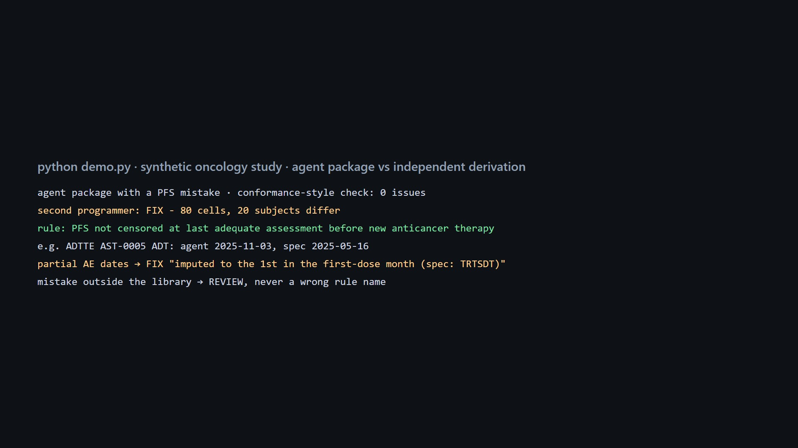

# A second programmer for AI-generated ADaM

Unofficial prototype by Kushagra Pratap Singh. Not affiliated with Astraea.

Astraea automates clinical-trial biometrics, from protocol and raw data to SDTM, ADaM and TFLs, with "QC, Pinnacle 21 checks" ([YC](https://www.ycombinator.com/companies/astraea)). Pinnacle 21 checks *conformance*: structure, controlled terminology, required variables. It can't know your SAP. A PFS that isn't censored at new anticancer therapy, or a TRTSDT taken from a held (zero-dose) first record, is perfectly conformant and still wrong. That's why sponsors QC ADaM by **independent double programming**. When an AI writes the first program in 7 days, the second program has to be automatic too. It also has to say *which rule* differs, not just "4,312 cells differ".



## What it does (`qc/`, stdlib)
- **`sdtm.py`: a synthetic oncology study.**
  - Domains: DM, EX (incl. held first doses and never-treated subjects), RS (scheduled assessments with windows, missed visits, NE, PD), DS deaths, CM new anticancer therapy, AE with partial dates.
- **`adam.py`: reference derivations from the spec, one named rule per step.**
  - ADSL: TRTSDT/TRTEDT from doses > 0, SAFFL, AGEGR1, DTHDT.
  - ADAE: partial-date imputation to TRTSDT in the first-dose month, no-day-0 ASTDY (SDTMIG), TEAE window from the SAP.
  - ADTTE PFS, following the [FDA 2018 endpoint guidance](https://www.fda.gov/media/71195/download) conventions:
    - no post-baseline assessment → censor at randomisation;
    - new anticancer therapy → censor at the last adequate assessment;
    - ≥ 2 missed assessments before the event → censor;
    - otherwise PD or death.

  Nine common alternative interpretations are switches.
- **`compare.py`: the QC.**
  - Cell-level diff against the independent derivation.
  - **Diagnosis**: re-derive with each known alternative interpretation. The one that reproduces the agent's package exactly names the broken rule (FIX); if none does, the package goes to REVIEW, never a guess.
  - A conformance-style baseline: CT values, study day 0, CNSR/ADT sanity.

```
$ python demo.py
agent package with 'ignore_newtx':
  conformance-style check: 0 issues
  second programmer: FIX - 80 cells, 20 subjects differ
  rule: PFS not censored at the last adequate assessment before new anticancer therapy (FDA 2018 PFS conventions)
  e.g. ADTTE AST-0005 ADT: agent '2025-11-03', spec '2025-05-16'
agent package with a mistake outside the library: REVIEW - differs from the independent derivation; no known interpretation explains it
```

## Results
**Held-out:** [`heldout/config.json`](heldout/config.json), frozen in git (commit `17d932c`) before the first run. A different study design:
- 6-weekly assessments ±3 days;
- more missed visits, new therapies and partial dates;
- a SAP with a 28-day TEAE window;
- two bug kinds **not** in the diagnosis library.

60 studies, first run:

| | result |
|---|---|
| packages with a known-kind bug that changed the data | 36 / 36 flagged, **36 / 36 named correctly**, 0 wrong names |
| packages with an unknown-kind bug that changed the data | 3 / 3 sent to REVIEW, 0 wrong names |
| clean packages | 0 / 12 flagged |
| conformance-style check on the same bugs | 3 / 39 (only "study day 0") |
| bugs that changed no value in that study | 9 (e.g. TRTEDT from a zero-dose record never occurred in this design); not counted |

Dev (60 studies, same design as the generator defaults): 41 / 41 named, 0 / 19 clean flagged, conformance 3 / 41.

## Honest limits
- **Near-circular.** The same person wrote the reference derivation and the "agent" mistakes. What the numbers really show is (a) conformance checks can't see SAP-level mistakes, and (b) "which rule broke" diagnosis works, and falls back to REVIEW when it doesn't know. A real QC would compare against Astraea's actual generated programs and the study's real SAP/ADRG.
- One mistake per package. Two at once would land in REVIEW (no single interpretation explains them), which is safe but less helpful. Pairwise search is the next step.
- PFS rules follow common FDA-guidance conventions. Sponsors' SAPs differ, which is why every rule is a switch.
- Synthetic data only.

## Run
```
python demo.py
python evaluate.py heldout      # ~10 s
python -m pytest -q             # 6 tests, stdlib only
```
